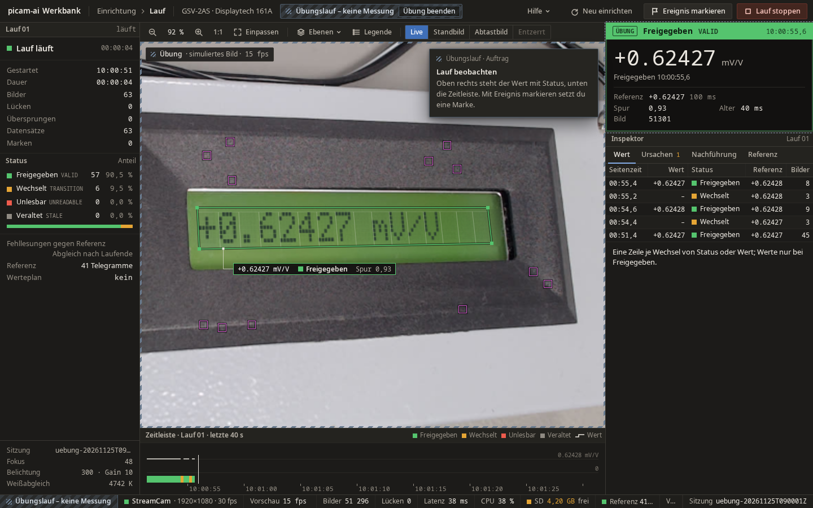

# picam-ai · dispread

picam liest die Anzeige eines Messverstärkers mit einer Logitech StreamCam
und protokolliert die Werte mit Zeitbasis und Freigabestatus. Die Werkbank
läuft auf dem Raspberry Pi und lässt sich im Browser bedienen.

<div class="wiki-messkette" data-messkette></div>

[Quickstart](#quickstart) · [Hilfe und Doku](#hilfe-und-doku) · [Screenshots](#screenshots) · [Release-Downloads](https://github.com/LeoMESysteme/picam-ai/releases/latest)

## Quickstart

Für den Start brauchst du einen Raspberry Pi 5 mit Raspberry Pi OS 13
(64 Bit), ein Linux-Konto mit Passwort und `sudo`-Zugang, eine Logitech
StreamCam an USB 3, einen GSV-2AS mit gut beleuchtetem Display und einen
USB-RS232-Adapter für die einmalige Timing-Kalibrierung.
[Kamera und Aufbau](docs/CAMERA_COMMISSIONING.md)

### 1. Installieren

Auf dem Pi in einem Terminal oder per SSH mit TTY ausführen.

```bash
curl -fsSL https://raw.githubusercontent.com/LeoMESysteme/picam-ai/master/get-picam.sh | bash
```

Für eine dauerhaft installierte Werkbank **Systemdienst** wählen. Bedienkonto,
erreichbare Adresse und Port bestätigen und den Dienst starten lassen. Die
Abschlusskarte nennt die HTTPS-Adresse. **Enter** öffnet die Einrichtungskonsole.
[Installer im Detail](docs/INSTALLER.md)

### 2. Anzeige einrichten

Im Browser die angezeigte Werkbank-Adresse (`/live`) öffnen. Beim ersten
Zugriff den Zertifikat-Fingerabdruck mit der Abschlusskarte oder dem Tab
**Zertifikat** in `picam` abgleichen. Dann mit dem Linux-Bedienkonto
anmelden und **Einrichtung starten** wählen. Ohne angeschlossenen
USB-RS232-Adapter den sichtbaren Anzeigewert eingeben. Vorschlag prüfen,
Namen eintragen und **Einheit mV/V und Format geprüft** abhaken. Bei einer
Warnung den Befund prüfen und **WARNUNG zur Kenntnis genommen** abhaken.
Dann **Bestätigen**.
[Zertifikat](docs/anleitung/10-kamera-livevorschau.md#zertifikat-auf-windows) · [Einrichtung](docs/anleitung/10-kamera-livevorschau.md#anzeige-einrichten)

### 3. Timing kalibrieren

Den USB-RS232-Adapter mit dem RS232-Ausgang des GSV-2AS verbinden.
Im Einrichtungsassistenten **Timing-Kalibrierung → Kalibrieren …**
wählen oder im Terminal ausführen.

```bash
picam kalibrieren
```

Auf das erfolgreiche Ergebnis und den Wiederanlauf der Werkbank warten.
Für einen lokalen Lauf kann der RS232-Adapter jetzt wieder abgezogen
werden. Danach die Werkbank im Browser neu öffnen, die Anzeige erneut
einrichten und bestätigen. [Timing-Kalibrierung](docs/INSTALLER.md#timing-kalibrieren)

### 4. Ersten Lauf starten

Über den Pfeil neben **Lauf starten** die Laufoptionen öffnen. Bei
**GSVmulti-Ausgabe** den Weg **Aus** wählen und **Lauf starten** drücken.
Ein stabil erkannter Wert erscheint als **Freigegeben** mit seiner Einheit.
Mit **Lauf stoppen** beenden. Das Audit heißt `records.jsonl` und liegt im
Laufordner unter `/var/lib/picam/live/` beim Standard-Systemdienst.
[Wertstatus und Laufablauf](docs/anleitung/10-kamera-livevorschau.md#lauf-und-wertstatus) · [Laufdateien](docs/anleitung/10-kamera-livevorschau.md#dateien-und-lokale-bedienung)

## Hilfe und Doku

| Wenn du … | Hier findest du Hilfe |
| --- | --- |
| **die Werkbank-Adresse suchst oder die Anmeldung scheitert** | `picam url` zeigt die Adresse, `picam status` den Dienstzustand. [Start und Anmeldung](docs/anleitung/10-kamera-livevorschau.md#start) |
| **kein Kamerabild siehst** | Mit `picam doctor` starten und den USB-3-Anschluss prüfen. [Kamera-Inbetriebnahme](docs/CAMERA_COMMISSIONING.md) |
| **„Lauf gesperrt“ siehst** | In `picam` den Kalibrierstatus und in der Werkbank die Einrichtung prüfen. [Laufsperre und Prüfmeldungen](docs/anleitung/10-kamera-livevorschau.md#laufstart-gesperrt) |
| **ohne Aufbau üben möchtest** | In der Werkbank **Hilfe → Übungslauf** wählen. [Bedienablauf](docs/anleitung/10-kamera-livevorschau.md#werkbank-bedienen) |
| **Werte in GSVmulti brauchst** | Ausgabeweg wählen und bei Bedarf die Windows-Brücke einrichten. [GSVmulti-Anbindung](docs/GSVMULTI_PROTOCOL.md) |
| **aktualisieren oder Probleme am Dienst untersuchen willst** | [Update und Rückweg](docs/INSTALLER.md#update-auf-die-neueste-version) · [Betrieb und Diagnose](docs/anleitung/09-betrieb.md) |

[Dokumentationsübersicht](docs/README.md) · [Glossar](docs/anleitung/glossar.md) · [Aktueller Projektstand](docs/status.md)

## Screenshots



*Werkbank im Übungslauf mit Beispieldaten.* [Einblicke in Installer und Konsole](docs/INSTALLER.md#screenshots)

## So kommst du zum ersten Messwert

<div class="wiki-pfad" id="weg-bedienen" markdown="1">

### Aufbauen

Kamera, Licht und Messverstärker kommen an ihren Platz, bevor Software ins Spiel kommt.

* [Kamera anschließen und prüfen](docs/CAMERA_COMMISSIONING.md#aktuell-logitech-streamcam-uvc) — StreamCam an einen USB3-Port, Diagnose mit `camera-commissioning.sh`
* [Halterung und Licht](docs/OPTICAL_SETUP.md#checkliste-vor-der-ersten-messreihe) — Checkliste vor der ersten Messreihe
* [Messverstärker anschließen](docs/HARDWARE_PROFILE.md) — GSV-2AS: Klemmenbelegung und Schnittstelle
* [Rechner und Schnittstellen](docs/HARDWARE_PROFILE.md#serielle-schnittstellen) — GSVmulti-Datenport `/dev/ttyAMA0`, Referenz über USB-RS232-Adapter

### Installieren

Die Werkbank läuft auf dem Pi; für GSVmulti kommt eine Brücke auf den Windows-Rechner.

* [Neuen Pi geführt installieren und mit `picam` verwalten](docs/INSTALLER.md) — Installation aus dem Release, danach Konsole und Einzelbefehle für Status, Diagnose, Dienst und Updates
* [Werkbank aus einem Entwicklungscheckout starten](docs/anleitung/10-kamera-livevorschau.md#entwicklungsdienst) — `scripts/install-workbench.sh` und `scripts/werkbank-dienst.sh` für den getrennten Entwicklungsbetrieb
* [Windows-Brücke und GSVmulti vorbereiten](docs/GSVMULTI_PROTOCOL.md#gsvmulti-start) — Setup oder portable EXE, virtuelles COM-Portpaar mit com0com oder SerialLoom

### Einrichten

Im Browser wird die Anzeige eingerichtet, geprüft und mit Namen bestätigt.
Eine neue Release-Installation braucht außerdem eine gültige Timing-Kalibrierung.

* [Werkbank im Browser öffnen](docs/anleitung/10-kamera-livevorschau.md#zertifikat-auf-windows) — HTTPS: dem Zertifikat des Pi auf Windows vertrauen
* [Anzeige einrichten und bestätigen](docs/anleitung/10-kamera-livevorschau.md#anzeige-einrichten) — Vorschlag prüfen, Befunde lesen, namentlich bestätigen
* [Kamera einstellen](docs/anleitung/10-kamera-livevorschau.md#kamera-einstellen) — Fokus und Automatiken
* [Timing bei der Inbetriebnahme kalibrieren](docs/INSTALLER.md#timing-kalibrieren) — `picam kalibrieren` mit vorübergehend angeschlossenem USB-RS232-Adapter

### Messen

Erst nach der Bestätigung startet ein Messlauf; jeder Wert trägt seinen Status.

* [Messlauf fahren und Wertstatus verstehen](docs/anleitung/10-kamera-livevorschau.md#lauf-und-wertstatus) — VALID, TRANSITION, UNREADABLE und STALE
* [Werte an GSVmulti ausgeben](docs/GSVMULTI_PROTOCOL.md) — Netzwerk über Brücke, UART direkt oder UART über Brücke, im Vierkanalprofil Gültigkeit über Kanal 2 auswerten
* [Referenz aufzeichnen](docs/anleitung/10-kamera-livevorschau.md#referenzaufzeichnung-und-abgleich) — GSV-2AS seriell mitschreiben und abgleichen

### Prüfen

Nach dem Lauf werden Ergebnisse angesehen und Auffälligkeiten eingeordnet.

* [Läufe ansehen](docs/session-explorer.md) — Session-Explorer: Kennzahlen und Dateien je Lauf
* [Wann ein Wert gültig ist](docs/uebersicht/messpfad.md) — Messpfad und Freigaberegeln
* [Typische Fehler](docs/anleitung/10-kamera-livevorschau.md#typische-fehler) — Meldung und nächster Schritt
* [Zeitstempel richtig lesen](docs/uebersicht/zeitstempel.md) — Zeitbasen und zulässige Schlüsse

</div>

## Tiefer gehen

<div class="wiki-wege" markdown="1">

### Konfigurieren und verstehen

Für alle, die Einstellungen anpassen und verstehen wollen, was dahinter passiert.

* [Messpfad und Freigabe](docs/uebersicht/messpfad.md) — wann ein Wert als gültig gilt
* [Kameraregler](docs/anleitung/10-kamera-livevorschau.md#kamera-einstellen) — Fokus und Automatiken
* [Zeitstempel richtig lesen](docs/uebersicht/zeitstempel.md) — Zeitbasen und zulässige Schlüsse
* [Glossar](docs/anleitung/glossar.md) — Begriffe und wo sie vorkommen

### Entwickeln und anbinden

Für Entwickler: Trennstellen, Verträge und Stellen, an denen man anbindet.

* [Lernpfad](docs/anleitung/README.md) — Werkzeuge, Kette, Baukapitel
* [Verträge](docs/anleitung/02-vertraege.md) — Schnittstellen und Datenklassen
* [Ausgabeprotokoll anbinden](docs/GSVMULTI_PROTOCOL.md#die-naht-im-code) — die Naht im Code
* [API-Referenz im Projektwiki](https://picam-docs.pages.dev/api/index.html) — Docstrings aller Module, mit Forgejo-Anmeldung

</div>

**Für Entwickler:** Die Verarbeitungskette im Projektwiki zeigt Zweck und Anbindung je Stufe.

<div class="wiki-kette" data-variant="kompakt" markdown="1">

Die Verarbeitungskette als Grafik braucht JavaScript im Projektwiki.
[Die Kette verstehen](docs/anleitung/01-kette-verstehen.md) beschreibt jede Stufe anhand eines Frames.

</div>

Zum Einstieg ohne Vorwissen: die [Projekt-Tour](docs/uebersicht/projekt-tour.md) zeigt das Projekt als Animation.

## Stand

<div class="wiki-stand" markdown="1">

* **Kamera:** Logitech StreamCam (UVC), aktiv seit 2026-09-25; die IMX500 ist außer Betrieb.
* **Messpfad:** In der Werkbank unter `/live` stehen Einrichtung, namentliche Bestätigung, Messlauf und JSONL-Audit zur Verfügung. Reale Prüfläufe betreffen den GSV-2AS mit Displaytech 161A, Raumlicht und mV/V ([Belege und offene Grenzen](docs/status.md)).
* **GSVmulti:** Werkbank und drei Ausgabewege wurden am 13.11. am GSV-2AS-Aufbau für die Bedienung abgenommen. Das native GSV-ASCII-Format ([OQ-07](docs/open-questions.md#oq-07)), die Systemabnahme auf Sperrgeräten und der 72-Stunden-Dauerlauf stehen aus. [Bewertung](docs/GSVMULTI_PROTOCOL.md) · [Roadmap](docs/ROADMAP.md)

</div>

**Projektstand:** [Aktueller Stand](docs/status.md) · [Roadmap](docs/ROADMAP.md) · [Offene Punkte](docs/open-questions.md) · [Arbeitsliste](TODO.md) · [Konzept](Konzept.md) (maßgeblich für Anforderungen)

## Alle Seiten

Die Tabellen führen zu den Anleitungen, Projektentscheidungen,
Messbelegen und Schnittstellen. Die [Dokumentationsübersicht](docs/README.md)
ordnet die Anleitungen nach Aufgaben.

### Projekt und Entscheidungen

| Seite | Inhalt |
| --- | --- |
| [Konzept](Konzept.md) | Anforderungen und Sicherheitsregeln |
| [Aktueller Stand](docs/status.md) | aktueller Arbeitsstand |
| [Codebase im Überblick](docs/uebersicht/codebase.md) | Umfang, Verlauf, Komplexität und Aufräumhinweise des Codes |
| [Arbeitsliste](TODO.md) | aktive Aufgaben |
| [Roadmap](docs/ROADMAP.md) | Phasen und Exit-Kriterien |
| [Geplante Features](PLANNED_FEATURES.md) | vorgesehene Funktionen |
| [Changelog](CHANGELOG.md) | Änderungshistorie |
| [Offene Punkte](docs/open-questions.md) | Fragen mit Zuständigkeit und Zielort |
| [Projektgeschichte](docs/project_history.md) | Entscheidungen und Alternativen |
| [Werkzeugrecherche](docs/tool_review_2026-09-08.md) | technische Abwägungen |

### Lernpfad und Nachschlagen

| Seite | Inhalt |
| --- | --- |
| [Anleitung](docs/anleitung/README.md) | Lernreihenfolge und Kapitelstatus |
| [0 · Werkzeuge](docs/anleitung/00-werkzeuge.md) | venv, Tests, Arbeitsrhythmus |
| [1 · Kette verstehen](docs/anleitung/01-kette-verstehen.md) | ein Frame durch alle Stufen |
| [2 · Verträge](docs/anleitung/02-vertraege.md) | Schnittstellen und Datenklassen |
| [3 · Bildquelle](docs/anleitung/03-erste-bildquelle-folder.md) | eigene Bildquelle bauen |
| [4 · Geräteprofile](docs/anleitung/04-geraeteprofile.md) | Layout und ROI |
| [5 · CLI](docs/anleitung/05-cli.md) | Workbench-CLI und geplanter Pipeline-Aufruf |
| [6 · Aufnahme und Replay](docs/anleitung/06-kamera-aufnahme-replay.md) | Frames aufzeichnen und wiedergeben |
| [7 · Lokalisierung](docs/anleitung/07-lokalisierung.md) | Anzeige finden und verfolgen |
| [8 · OCR-Backends](docs/anleitung/08-ocr-backends.md) | Leser vergleichen |
| [9 · Betrieb](docs/anleitung/09-betrieb.md) | Dienst prüfen und Dauerlauf vorbereiten |
| [Kamera-Livevorschau](docs/anleitung/10-kamera-livevorschau.md) | Workbench bedienen |
| [Datensatz sammeln](docs/anleitung/11-datensatz-sammeln.md) | geführter Sammelmodus |
| [Rezepte](docs/anleitung/rezepte.md) | kurze ausführbare Beispiele |
| [Glossar](docs/anleitung/glossar.md) | Fachbegriffe |
| [Projekt-Tour](docs/uebersicht/projekt-tour.md) | Projekt als Animation in Kapiteln |
| [Messpfad und Freigabe](docs/uebersicht/messpfad.md) | Entscheidungen je Frame |
| [Zeitstempel lesen](docs/uebersicht/zeitstempel.md) | Zeitbasen und zulässige Schlüsse |
| [Daten und Abnahme](docs/uebersicht/daten-und-abnahme.md) | Splits, Evidenz und Kennzahlen |

### Betrieb und Hardware

| Seite | Inhalt |
| --- | --- |
| [Kamera-Inbetriebnahme](docs/CAMERA_COMMISSIONING.md) | Diagnose und Fehlerbaum |
| [Hardwareprofil](docs/HARDWARE_PROFILE.md) | Rechner, Ports, Konfiguration |
| [Optischer Aufbau](docs/OPTICAL_SETUP.md) | Halterung, Licht, Reflexionen |
| [Displaybus-Abgriff](docs/DISPLAYBUS_TAP.md) | Konzept einer Sollwertquelle |
| [GSVmulti-Protokoll](docs/GSVMULTI_PROTOCOL.md) | bekannte und offene Formatfragen |
| [Abhängigkeiten](docs/dependencies.md) | Systempakete und Projekt-venv |
| [Doku-Hosting](docs/HOSTING.md) | Build, Runner und Veröffentlichung |

### Messungen

| Seite | Inhalt |
| --- | --- |
| [Session-Explorer](docs/session-explorer.md) | Gesamtkennzahlen, Entwicklung und Originaldateien abgeschlossener Läufe |
| [Fortschritt Ernten/Training](docs/FORTSCHRITT.md) | interaktive Diagramme |
| [Validierung](docs/VALIDATION.md) | Zahlen und Fehlerklassen |
| [Zeitverhalten](docs/TIMING.md) | M1–M8 und Unsicherheitsbudget |
| [Laborjournal](docs/lab_journal.md) | Aufbau, Beobachtung und Deutung |

### API und Projektregeln

| Seite | Inhalt |
| --- | --- |
| [API-Überblick](https://picam-docs.pages.dev/api/index.html) | Einstieg in die Docstrings im Projektwiki (Forgejo-Anmeldung) |
| [Verträge und Datensätze](https://picam-docs.pages.dev/api/vertraege.html) | Record, Zeitstempel, Profile |
| [Bildquellen](https://picam-docs.pages.dev/api/frames.html) | Quellen und Frames |
| [Anzeige finden](https://picam-docs.pages.dev/api/detect.html) | Lokalisierung |
| [Geometrie](https://picam-docs.pages.dev/api/geometrie.html) | Nachführung und Entzerrung |
| [OCR](https://picam-docs.pages.dev/api/ocr.html) | Leser und Leseergebnisse |
| [Freigabe](https://picam-docs.pages.dev/api/validate.html) | Gate-Entscheidungen |
| [Ausgabe](https://picam-docs.pages.dev/api/sink.html) | JSONL, seriell, Formatter |
| [Pipeline](https://picam-docs.pages.dev/api/pipeline.html) | Verdrahtung und Trace |
| [Workbench](https://picam-docs.pages.dev/api/workbench.html) | Bedienoberfläche |
| [AGENTS.md](AGENTS.md) | verbindliche Projektregeln |
| [CLAUDE.md](CLAUDE.md) | ergänzender Entwicklerkontext |

## Lokal arbeiten

Die Projekt-venv nutzt Debian-Pakete mit system-site-packages; das Paket
wird mit no-deps installiert. Einzelheiten stehen in
[Abhängigkeiten](docs/dependencies.md). Das End-to-End-Beispiel läuft ohne
Hardware und liefert **keine** reale Latenzaussage
([Zeitstempel](docs/uebersicht/zeitstempel.md)).

    python3 -m venv --system-site-packages .venv
    ./.venv/bin/pip install --no-deps -e .
    ./.venv/bin/pytest -q
    ./.venv/bin/ruff check src tests examples
    ./.venv/bin/python examples/16_end_to_end_headless.py
