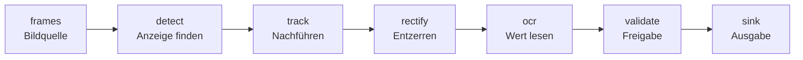

# API-Referenz

Erzeugt beim Bauen der Seite direkt aus den Docstrings in `src/dispread`, ohne KI.
Die generierten Signaturen und Docstrings spiegeln den Code; die
Einordnung davor beschreibt den aktuellen Einsatz. Die Reihenfolge folgt der Verarbeitungskette
aus Konzept.md §3:

Für die fachliche Einordnung der Signaturen siehe
[Messpfad und Freigabe](../docs/uebersicht/messpfad.md),
[Zeitstempel richtig lesen](../docs/uebersicht/zeitstempel.md) und
[Daten und Abnahme](../docs/uebersicht/daten-und-abnahme.md).

Stand: 2026-10-21. Der Live-Pfad verwendet die StreamCam, ein bestätigtes
Profil und `DotMatrixReader`; GSVmulti ist noch nicht angeschlossen.
Die serielle Gegenprobe wird separat aufgezeichnet und nachträglich
verglichen.

| Seite | Inhalt |
| --- | --- |
| [Verträge und Datensätze](vertraege.md) | `ValueRecord`, Zeitstempel, Raster, Sitzungsprofil |
| [Bildquellen](frames.md) | `v4l2://`, `synthetic://`, `replay://`, Quellen-Registry und gemeinsamer `CameraOwner` |
| [Anzeige finden](detect.md) | manuelle ROI |
| [Nachführen und Entzerren](geometrie.md) | `QuadTracker`, Vierpunkt-Entzerrung, Glas-Quad |
| [Wert lesen](ocr.md) | aktiver Dot-Matrix-Leser, daneben Sieben-Segment, tesseract und Autofit |
| [Freigabe](validate.md) | Freigaberegeln |
| [Ausgabe](sink.md) | JSONL, seriell, Telegrammformate |
| [Pipeline](pipeline.md) | Verdrahtung, `PipelineTrace`, Live-Sitzung und getrennte Referenzaufzeichnung |
| [Workbench](workbench.md) | ältere Werkbank und `/live` mit Einrichtung, Bestätigung und Laufsteuerung |
