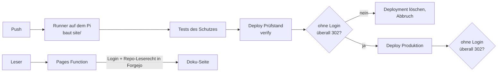

# Doku-Hosting: Cloudflare Pages mit Forgejo-Anmeldung

Die Doku-Seite baut der Forgejo-Runner auf dem Pi (`.github/workflows/docs.yml`)
und veröffentlicht sie unter **https://picam-docs.pages.dev**. Ein Offline-ZIP
wird nicht mehr erzeugt. Lesen darf die Seite nur, wer sich über
Forgejo anmeldet **und das Repo `l.hentschke/picam-ai` lesen darf**.

Ein Push auf `master` baut und veröffentlicht die Seite automatisch, sofern
`CLOUDFLARE_PAGES_PROJECT` gesetzt ist. Ein
manuell gestarteter Lauf darf Build, Tests und den Prüfstand ausführen, aber
nie das produktive Deployment überschreiben; ebenso wenig ein Feature-Branch.



## Wie der Schutz funktioniert

`cloudflare/functions/_middleware.js` ist eine **Pages Function**. Sie steckt
in jedem Deployment und läuft vor **jeder** Anfrage, auch vor statischen
Dateien und dem Suchindex.

1. Ohne gültige Sitzung leitet sie zur Forgejo-Anmeldung weiter
   (OAuth2 mit PKCE und signiertem `state`).
2. Nach der Rückkehr tauscht sie den Code gegen einen Token und fragt damit
   `GET /api/v1/repos/l.hentschke/picam-ai` ab. Nur bei `permissions.pull == true`
   gibt es eine Sitzung. Den Token verwirft sie danach.
3. Die Sitzung ist ein HMAC-signiertes Cookie (`__Host-`, `Secure`, `HttpOnly`)
   mit 8 h Laufzeit. Wem in Forgejo das Leserecht entzogen wird, verliert den
   Zugang also spätestens nach 8 h.
4. Im Zweifel lehnt sie ab: Fehlt Konfiguration, kommt 500; ist Forgejo nicht
   erreichbar, kommt 502; ist das Cookie ungültig, geht es zurück zur Anmeldung.

Tests: `node --test cloudflare/test/middleware.test.js`. Sie decken ab:

* Ablehnung ohne, mit abgelaufener, manipulierter und fremd signierter Sitzung
* fehlende und schwache Konfiguration
* falschen `state` und fehlendes Leserecht
* offene Weiterleitungen
* den erfolgreichen Durchlauf

Historische Entscheidung vom 2026-09-23: Die Einrichtung von Cloudflare
Access verlangte damals eine hinterlegte Kreditkarte; gewählt wurde deshalb
eine Pages Function mit Forgejo-Repo-Prüfung. Damals wurde das kostenlose
Workers-Kontingent mit 100 000 Anfragen pro Tag zugrunde gelegt. Das ist
keine Prüfung heutiger Cloudflare-Tarife. Die abgewogenen Alternativen
stehen in [project_history.md](project_history.md), Eintrag vom 2026-09-23.

## Was eingerichtet ist (2026-09-23)

| Wo | Was |
| --- | --- |
| Cloudflare, Pages-Projekt `picam-docs` | Production branch `master`. Variablen: `OAUTH_CLIENT_ID`; als Secret: `OAUTH_CLIENT_SECRET`, `SESSION_SECRET` |
| Cloudflare, API-Token „picam-docs deploy“ | nur *Pages Write* für dieses Konto, läuft am 2027-09-23 ab |
| Forgejo, OAuth2-Anwendung „Doku-Seite picam-docs“ | vertraulicher Client, Weiterleitung nur `https://picam-docs.pages.dev/_auth/callback` |
| Forgejo, Repo → Einstellungen → Actions | Secret `CLOUDFLARE_API_TOKEN` (Deploy-Token), Variablen `CLOUDFLARE_ACCOUNT_ID`, `CLOUDFLARE_PAGES_PROJECT` |

Vorschau-Adressen (`verify.picam-docs.pages.dev`, `<hash>.picam-docs.pages.dev`)
sind ebenfalls geschützt. Anmelden kann man sich dort aber nicht, denn in
Forgejo ist nur die Produktivadresse als Weiterleitung eingetragen. Der
Prüfstand dient nur der automatischen Schutzprüfung.

## Wartung

### Session-Archiv und Explorer

Der [Session-Explorer](session-explorer.md) ist Teil des normalen Wikis.
Ein Build ohne Archiv enthält einen klaren Leerzustand. Die bestehenden
Playwright- und Doku-Pflege-Workflows bekommen weder Zugriff auf `var/live`
noch eine neue lokale Abhängigkeit. Ein zusätzlicher Schritt in `docs.yml`
ergänzt ausschließlich bei Push auf `master` eine bereits geprüfte Generation
im Buildverzeichnis `site/`. Manuelle Prüfstandsdeployments verändern weiterhin
keine Produktion. Anmeldung und Schutzprüfung gelten auch für Katalog,
Manifeste, komprimierte Teile und die eigenständige Explorer-Seite.
Der optionale Schritt legt für den Standardbibliothekshelfer eine Projekt-venv
mit `--system-site-packages --without-pip` an. Es wird kein Paket installiert.
Schlägt schon diese Vorbereitung fehl, bleibt der normale Wiki-Build mit
Leerzustand gültig; die bisherigen übrigen Workflows brauchen diese venv nicht.

**Einrichtung einmalig, in einer Messpause:**

```bash
sudo ./scripts/wiki-session-export-install.sh
```

Das Skript installiert nur `picam-wiki-export.service` und `.path`, den
Standardbibliotheks-Exporter und seine feste Konfiguration. Es startet weder
die Workbench noch bestehende Runner neu. Der Dienst läuft als `me-systeme`,
mit `PrivateDevices`, lesbarem Home, geschütztem System, 25 % eines CPU-Kerns,
256 MiB Speicher und niedriger CPU-/I/O-Priorität. Der Runner kann nur eine
feste Anfrage schreiben und fertige Archivgenerationen lesen; er erhält keinen
Zugriff auf Home, Steuersocket oder Geräte. Inhalt der Anfragedatei wird nicht
gelesen und nicht als Befehl oder Parameter verwendet.

Das Skript ist idempotent. Ein erneuter Lauf aktualisiert Code und Units,
startet nur `picam-wiki-export.path` neu und migriert ein älteres Archiv:
Gruppe `forgejo-runner` und setgid auf allen Archivverzeichnissen,
`blocks/` auf 2700 mit 0640-Dateien, `snapshots/` auf 2750. Die frühere
Anfragedatei `/srv/picam-wiki-export/request` wird entfernt. Die neue
Anfragedatei legt der Runner beim ersten Deploy selbst an; root schreibt
nichts in sein Verzeichnis.

**Einmalige Kosten nach diesem Update:** Der Integritätscache bekommt ein
neues Schlüsselformat, und alle Läufe mit vorhandener Quelle werden nach den
neuen Zählregeln neu ausgewertet. Das braucht mehrere Exportphasen
(je 45 s bei 25 % CPU); bis dahin bleibt der bisherige Archivstand sichtbar.
Nach dem Update in einer Messpause einige Phasen anstoßen (Befehl unten).

Das nächste reguläre Produktionsdeployment schreibt
`/var/lib/forgejo-runner/wiki-export-request` und wartet höchstens 15 s.
Der Runner läuft mit `ProtectSystem=strict` und darf nur unter
`/var/lib/forgejo-runner` schreiben; eine Anfrage unter `/srv` scheiterte
früher still mit EROFS. `picam-wiki-export.path` beobachtet die Datei als
systemd (root); der Exportdienst braucht keinen Zugriff darauf, und der
Runner keinen Neustart. Scheitert das Schreiben, steht der Fehler als
`request_error` im JSON-Ergebnis des CI-Schritts, und es wird nicht
gewartet. Der Exportdienst
arbeitet pro Anfrage höchstens 45 s, mit zusätzlicher systemd-Zeitgrenze von
75 s. Bei laufendem `dispread serve` oder unklarem Prozessstatus importiert er
nichts. Startet eine Workbench während der Bearbeitung, endet sie am nächsten
begrenzten Prüfschritt. Die Workbench wird niemals angehalten oder am Start
gehindert. Das ersetzt keine harte Ressourcenisolation: Builds und Browsertests
gehören auf dem gemeinsamen Pi weiterhin in Messpausen.

Der dauerhafte Bestand liegt unter `/srv/picam-wiki-export/archive`:
`checkpoint.sqlite3` enthält wiederaufnehmbare Dateiblöcke und numerische
Beobachtungen, `blocks/` die komprimierten Originalblöcke, `snapshots/`
unveränderliche Generationen. Die atomare Textdatei `current` nennt die aktuelle
Generation; ein `published`-Beleg unterscheidet sie von abgebrochener Arbeit.

Rechte: `archive/` gehört `me-systeme:forgejo-runner` mit 2750 (setgid).
Der Dienstnutzer ist **nicht** in `forgejo-runner`; alles, was er anlegt,
erhält die Gruppe nur über setgid-Vererbung. Ein `chmod` durch ihn löscht
setgid (Kernelregel für Nichtmitglieder), und `chown` auf diese Gruppe ist ihm
verboten. Deshalb legt der Dienst Dateien nie in einem Verzeichnis an, das er
schon umgestellt hat, und ruft kein `chown` auf. `blocks/` ist der gemeinsame
Chunk-Speicher: Dateien 0640, das Verzeichnis privat 2700, für den Runner
also unerreichbar. Jede Generation verweist per Hardlink auf dieselben
Inodes, kostet also keinen zusätzlichen Platz und muss bei der Freigabe nicht
kopiert werden. Checkpoints und Integritätscache bleiben 0600
(`UMask=0077`). Eine neue Generation entsteht als privates 0700-Verzeichnis.
Erst nach vollständiger Publikation prüft der Dienst, dass jeder Eintrag die
Archivgruppe trägt (sonst Fehler statt einer für den Runner unlesbaren
Generation), öffnet dann alle Dateien, danach die Verzeichnisse von unten nach
oben und `current` zuletzt. Bei Generationsverzeichnissen geht setgid dabei
verloren; das ist unschädlich, weil darin nichts mehr angelegt wird.

Bereinigung: Nach jeder erfolgreichen Publikation bleiben `current` und bis
zu drei vorherige Generationen erhalten (bevorzugt eine bereits für den Runner
freigegebene). Ältere Generationen, abgebrochene Staging-Verzeichnisse und
nicht freigegebene Generationen werden entfernt; eine Generation wird erst
atomar aus `snapshots/` verschoben und dann gelöscht. Den Runnerzustand
`/var/lib/forgejo-runner/wiki-session-state.json` kann der Dienst nicht
lesen. Zeigt er auf eine schon entfernte Generation, fällt der Runner auf
`current` zurück. Zwei Publikationen während eines einzigen Deploys könnten
ihm die gerade gelesene Generation entziehen; Prüfsummen und Dateizugriffe
fangen das ab, das Deploy bleibt dann ohne neu eingebundene Sessions
(Leerzustand des Builds), die Schutzprüfung bleibt unberührt. Lehnt der
Runner mehr als drei Generationen hintereinander ab (etwa weil das Archiv
die Hosting-Grenzen übersteigt), gibt es keinen älteren Rückfallstand mehr.
Generationen teilen sich die Blöcke als Hardlinks: Ein beschädigter Block
trifft alle Generationen zugleich, und der Exporter bemerkt das wegen des
Integritätscaches nicht; der Runner prüft jede Prüfsumme und lehnt dann ab.
Eine automatische Reparatur gibt es dafür noch nicht.
`blocks/` selbst wird nicht bereinigt: Blöcke bereits übernommener Läufe
bleiben dauerhaft, auch wenn lokale Quellen verschwinden.
Eine veränderte Quelle unter derselben Laufkennung wird als Konflikt gemeldet.
Dieses Verzeichnis separat sichern.

```bash
# Nach beendeter Workbench eine Exportphase anfordern:
sudo systemctl start picam-wiki-export.service
sudo journalctl -u picam-wiki-export.service -n 20 --no-pager
```

Große Läufe können mehrere Exportphasen benötigen. Hashing, Komprimierung und
JSONL-Verarbeitung setzen innerhalb einer Datei am letzten geprüften Block
fort; fertige exakte Statistiken werden zwischengespeichert. Eine unterbrochene
einzelne SQL-Abfrage beginnt erneut, ohne doppelte Beobachtungen einzufügen.
Das Zeitbudget wird bei jedem Prüfschritt und in jedem SQLite-Progress-Callback
geprüft. Der teurere Prozessscan (`/proc`) läuft höchstens alle 100 ms, im
Exporter wie bei der Freigabe; der erste Prüfschritt jeder Exportphase scannt
immer, sodass eine laufende Workbench jeden Quellzugriff verhindert. Der
Integritätscache verifizierter Blöcke ist an Inode, Größe und mtime gebunden,
nicht an ctime: Hardlinks und `chmod` ändern ctime und lösten früher bei
jeder neuen Generation ein vollständiges Neuhashen aus. Neue Blöcke werden
einmal gehasht, der Fortschritt bleibt über abgebrochene Phasen erhalten.
Wird eine Phase nach dem Anlegen einer Generation, aber vor ihrem
`published`-Beleg abgebrochen, entfernt der Exporter diese Generation sofort.
Blockierende Systemaufrufe können die kooperative
Reaktion verzögern; eine garantierte Stoppzeit wird damit nicht behauptet.
Die Rohdateien sind in unabhängig komprimierte Blöcke von höchstens 1 MiB
aufgeteilt. Metadatendateien über 1 MiB werden abgelehnt; JSONL-Zeilen über
1 MiB bleiben in den Originaldateien erhalten, zählen aber als nicht auswertbar.
Statistikfehler und ausgelassene Zeilen sind sichtbar, fehlende Zahlen sind
`null` und niemals eine erfundene Nullmessung.

Annahmeregel wie im Records Explorer: Ein Frame ist ein JSON-Objekt mit
Zeichenketten-`status` und endlichem `capture_timestamp.value_ns`. Alles andere,
auch zu tief verschachtelte Zeilen, zählt als nicht auswertbare Zeile
(`invalid_lines`, Hinweis `invalid-record-lines`). Die Statusanteile der
gezählten Frames ergeben damit 100 %; unbekannte Statuswerte erscheinen unter
ihrem eigenen Namen. Ein Fehler in den Metadaten eines Laufs landet in
`errors` und hält die übrigen Läufe nicht auf.
Leserate je Lauf: `(n − 1) / ((t_last − t_first) / 1e9)` Hz, mit `n`
gezählten Frames und erstem/letztem Aufnahmezeitstempel, nur bei einheitlicher
bekannter Zeitbasis und monotoner Folge. Gruppen: gleich gewichtet der
Mittelwert der Laufraten, frame-gewichtet `Σ(n_i − 1) / Σ Dauer_i` über Läufe
mit Dauer. Jeder Lauf trägt die Regelversion in `stats.rules` (aktuell 2).
Bereits archivierte Läufe mit älterer Regel werden einmalig aus den
gespeicherten Blöcken neu ausgewertet (nur Entpacken und Parsen, ohne
Quellzugriff auf `records.jsonl`, blockweise fortsetzbar); die Dateiteile
bleiben identisch. Das gilt für Läufe, deren Quellverzeichnis noch existiert.
Läufe ohne lokale Quelle behalten die Statistik ihrer Übernahme und sind am
fehlenden `stats.rules` erkennbar.

Kommt keine neue Generation rechtzeitig an, bleibt der letzte geprüfte Stand
sichtbar. Die Veröffentlichungsseite nennt immer das Archivdatum; während
einer dauerhaft geöffneten Workbench kommen keine neuen Sessions hinzu.
Der Runner merkt den letzten erfolgreich eingebundenen Stand unter
`/var/lib/forgejo-runner/wiki-session-state.json`. Bei beschädigten oder zu
großen Daten wird ein früherer gültiger Stand verwendet, sonst eine leere
Ansicht mit Hinweis. Grenzen werden für Website **und** Archiv zusammen
geprüft. Ein Fehler der Authentifizierung oder Schutzprüfung verhindert das
Deployment weiterhin.

Eine künstliche Integrationsgeneration lässt sich ohne Dienst und echte
Sessions in einen separat gebauten Prüfstand einbinden:

```bash
./.venv/bin/python scripts/wiki_session_site.py --site site --snapshot /pfad/zur/fixture-generation
```

Die aktuelle Quelle ist das konfigurierte `var/live` des installierten
Checkouts, nicht ein beliebiger Worktree. Bereits gelöschte historische Läufe
werden nur aus einer vorhandenen Sicherung wiederherstellbar. Weder
Diagnosebilder noch Vorlagen, Videos oder beliebige Pfade aus Metadaten werden
mitveröffentlicht. Ohne native Browserentpackung stehen die gzip-Teile weiter
zum Download bereit; Reihenfolge und Prüfsummen stehen im Manifest.

### Playwright-Prüfung auf dem vorhandenen Runner

`.github/workflows/playwright.yml` läuft bei Pushes und Pull Requests nach
`main`/`master` sowie manuell auf `picam-docs`, dem vorhandenen Host-Runner.
`ubuntu-latest` war ein Überbleibsel der GitHub-Vorlage und passte zu keinem
hier konfigurierten Runner-Label; deshalb blieben die Jobs in der Warteschlange.

Der Workflow verwendet Node 22 und Chromium mit einem Worker, baut die Doku
streng und prüft anschließend ihre interaktiven Funktionen. Browserdateien
liegen unter `/var/lib/forgejo-runner/playwright-browsers`. Die Installation
verwendet `playwright install --only-shell chromium` ohne `--with-deps`;
Systembibliotheken müssen auf dem Pi bereits installiert sein. Der Job
bekommt keine Rechte für `apt` oder Zugriff auf Messhardware. Berichte lädt
die Forgejo-Version von `upload-artifact@v4` hoch.
Einzige Playwright-Suite ist `tests/docs-site.spec.ts`; `playwright.config.ts`
reicht nur `playwright.docs.config.ts` durch. `*.test.mjs`-Harnische laufen
separat über Pytest mit ihren benötigten Fixtures.

Das Runner-Label bleibt `picam-docs:host`; `ubuntu-latest` wird nicht als
allgemeines Alias ergänzt. Bereits wartende Läufe mit der alten
Workflow-Version müssen beendet und nach Übernahme der Korrektur neu
gestartet werden.

### Automatische Zensical-Pflege einrichten

Der bisherige Claude-`@reboot`-Eintrag ist deaktiviert. Forgejo startet
`.github/workflows/docs-maintenance.yml` täglich um 06:00 Uhr Berliner Zeit;
ist der Pi aus, wartet der Lauf auf das Runner-Label `picam-codex-docs`.
Manuell gestartete Läufe erzeugen standardmäßig nur einen geprüften Patch als
Action-Artefakt. Mit `mode=publish` dürfen sie nach erfolgreichen Prüfungen
direkt nach `master` pushen. Der bestehende `docs.yml`-Workflow übernimmt
anschließend den Cloudflare-Deploy und dessen Schutzprüfung.
Der Patch-Upload verwendet die Forgejo-Version von `upload-artifact@v4`.
`navigation.tracking` bleibt deaktiviert, weil es beim mobilen Seitenwechsel
gelegentlich den Abschnittsanker des Ausgangstextes in die Ziel-URL schrieb.
Sofortnavigation und Hover-Vorschauen bleiben aktiviert.

Der Runner und die Messung teilen denselben Pi. Trotz CPU-/I/O-Grenzen
wurden am 2026-10-21 bei einem CI-Lauf Stillstände bis 44 s und STALE
beobachtet ([Status](status.md)). Builds, Browsertests und Pushes, die CI
auslösen, deshalb außerhalb laufender Messungen einplanen.

Einmalige Einrichtung auf dem Pi:

1. In Forgejo unter **Repo → Einstellungen → Actions → Runners** einen neuen,
   nur für dieses Repo registrierten Runner anlegen. UUID und Token erhalten
   einen eigenen Eintrag. **Nur den Token** in einer lokalen Datei mit Modus
   `0600` ablegen; die UUID bleibt ein Argument. Token nie in Kommandozeile,
   Repo oder Chat schreiben:
   ```bash
   umask 077
   nano "$HOME/.forgejo-codex-runner-token"
   chmod 600 "$HOME/.forgejo-codex-runner-token"
   ```
   Falls Forgejo den Token nicht mehr anzeigt, einen neuen Runner registrieren
   und dessen UUID und Token zusammen verwenden.
2. `sudo ./scripts/forgejo-codex-runner-install.sh --uuid <UUID> --token-file "$HOME/.forgejo-codex-runner-token"`
   ausführen. **`forgejo-runner-install.sh` gehört zum bestehenden
   `picam-docs`-Runner.** Das Codex-Skript installiert die gepinnte Codex CLI,
   den Systemnutzer `picam-codex-runner` und den ressourcenbegrenzten Dienst.
   Der vorhandene `picam-docs`-Runner bleibt für den Cloudflare-Build zuständig.
3. Unter dem neuen Systemnutzer einmalig anmelden:
   ```bash
   sudo -u picam-codex-runner env HOME=/var/lib/picam-codex-runner \
     CODEX_HOME=/var/lib/picam-codex-runner/.codex \
     /opt/picam-codex/node_modules/.bin/codex \
     -c 'cli_auth_credentials_store="file"' login --device-auth
   ```
   Den Gerätecode im eigenen Browser bestätigen. Danach muss
   `auth.json` nur für diesen Benutzer lesbar sein (`0600`); die Datei
   bleibt zwischen Läufen bestehen und wird nie ins Repo kopiert.
   Falls Gerätecodes nicht freigegeben sind, erlaubt die
   [OpenAI-Dokumentation](https://learn.chatgpt.com/docs/auth#login-on-headless-devices)
   stattdessen eine Kopie der vorhandenen lokalen Anmeldedatei:
   ```bash
   chmod 600 "$HOME/.codex/auth.json"
   sudo install -m 600 -o picam-codex-runner -g picam-codex-runner \
     "$HOME/.codex/auth.json" /var/lib/picam-codex-runner/.codex/auth.json
   sudo -u picam-codex-runner env HOME=/var/lib/picam-codex-runner \
     CODEX_HOME=/var/lib/picam-codex-runner/.codex \
     /opt/picam-codex/node_modules/.bin/codex login status
   ```
   Die Kopie nutzt dasselbe ChatGPT-Konto, liegt aber nur im geschützten
   Runner-Verzeichnis.

   **Dauerhaft gekoppelt (Standard seit 2026-10-28):** Zwei unabhängige
   Kopien derselben Anmeldung laufen auseinander. Erneuert die lokale
   Codex-Sitzung ihr Token, wird das Refresh-Token der Kopie ungültig, und
   der Pflegelauf endet mit `workspace routing discovery unauthorized
   (401)`. Deshalb hält ein root-Dienst die Runner-Datei mit
   `~/.codex/auth.json` gleich:
   ```bash
   sudo ./scripts/picam-codex-auth-sync-install.sh
   ```
   Der Installer legt `/usr/local/bin/picam-codex-auth-sync`,
   `picam-codex-auth-sync.service` und `.path` an. Die Path-Unit startet den
   Abgleich bei jeder Änderung einer der beiden Dateien, der Dienst läuft
   zusätzlich beim Start. Maßgeblich ist die zuletzt erneuerte Fassung
   (`last_refresh`). Meist geht sie vom Entwickler zum Runner. Erneuert der
   Runner selbst, geht seine Fassung zurück, sonst würde die lokale
   Anmeldung ungültig. Die Runner-Datei gilt als unvertrauenswürdig: keine
   Symlinks, nur reguläre Dateien des erwarteten Eigentümers. Zurück ins
   Home-Verzeichnis geht sie nur mit derselben `account_id`. Der Runner
   selbst bekommt weiterhin keinen Zugriff auf `/home`. Ob der Abgleich
   lief, zeigt `journalctl -u picam-codex-auth-sync.service`.
4. Einen Forgejo-PAT mit `write:repository` und Zugriff **nur auf dieses Repo**
   anlegen. Dafür kann das eigene Konto oder ein separater Bot genutzt werden.
   Den PAT als Repo-Secret `DOCS_BOT_TOKEN` hinterlegen und den zugehörigen
   Forgejo-Benutzernamen als Repo-Variable `DOCS_BOT_USERNAME` setzen. Falls
   `master` geschützt ist, braucht der Benutzer die ausdrücklich erlaubte
   Push-Berechtigung. Der automatische `FORGEJO_TOKEN` kann den Publish-Schritt nicht ersetzen:
   seine Pushes lösen keine weiteren Actions aus.
5. Einen manuellen Lauf mit `mode=preview` starten und den Patch prüfen.
   Danach einen kleinen `mode=publish`-Lauf abnehmen: Bot-Commit, neuer
   `docs.yml`-Lauf, geschütztes Cloudflare-Deployment und Hover-Vorschau.

Der Job nutzt einen frischen Checkout und berührt keine lokalen Worktrees.
Die automatische Schreibfreigabe in `scripts/docs-maintenance.py` umfasst
`README.md`, `zensical.toml`, Status, Roadmap, neue OQs sowie Markdown unter
`docs/anleitung/` und `docs/uebersicht/`. `docs/README.md` ist zwar ein
Prüfziel, gehört aber derzeit nicht zu den erlaubten Schreibpfaden;
Korrekturen dort und auf den übrigen Fachseiten brauchen einen gesonderten
Doku-Auftrag.
Er prüft anfangs täglich drei Anleitungsseiten, bis die erste Runde fertig
ist. Danach ruft er Codex nur bei Änderungen seit dem letzten erfolgreichen
Audit oder für eine wöchentlich wechselnde Anleitungsseite auf. Der Auftrag
nennt sämtliche geänderten Dateien und beide Diff-Grenzen; falls der letzte
Audit-Commit nicht mehr erreichbar ist, erhält Codex eine vollständige
Dateiliste für einen neuen Ausgangspunkt. Das Modell
ist standardmäßig `gpt-6-luna`; höchstens zwei lesende Subagents helfen bei unabhängigen
Bereichen. Der erste Codex-Lauf ist auf 20 Minuten begrenzt, der Workflow
auf 60 Minuten. ChatGPT-Anmeldung hat keine technisch durchsetzbare
10-USD-API-Kostengrenze; die Forgejo-Logs enthalten Status, Token-Nutzung,
Gate-Ausgaben und die letzte Antwort von Codex, keine Anmelde- oder
Bot-Tokens. Das vollständige Codex-JSONL bleibt privat auf dem Runner unter
`CODEX_HOME`; bei fehlgeschlagenem Gate gibt es keinen Push.

Seit 2026-10-13 gilt außerdem:

* **Vorabprüfung:** `probe` führt `oq-index.py --check` und
  `tour-facts.py --check` aus, bevor Codex startet. Weicht eines davon ab,
  bricht der Job ohne Codex-Aufruf ab; die Meldung nennt die betroffenen
  Tour-Schritte. Beides darf Codex nicht beheben, ein Lauf würde nur Token
  verbrauchen und im Build scheitern.
* **Korrekturrunden:** Lehnt das Gate den Stand ab (Pfad außerhalb des
  Rahmens, Link im Codeblock, geänderter OQ-Eintrag, fehlender Status,
  Build, Vorschauziele, Browsertests), setzt es dieselbe Codex-Session mit
  `codex exec resume <thread-id>` und der Gate-Meldung fort. Höchstens zwei
  Runden zu je 8 Minuten, danach scheitert der Job. `exec resume` hat
  keinen `--sandbox`-Schalter und übernimmt die Sandbox des ersten Laufs
  nicht; ohne `-c sandbox_mode="workspace-write"` läuft die Runde read-only
  (geprüft mit codex-cli 0.156.1). Jede Runde sendet den bisherigen Verlauf
  erneut, überwiegend aus dem Cache. Codex bleibt auf die Doku-Pfade
  beschränkt; Code, Szenen und Tests ändert es auch in einer Korrekturrunde
  nicht.
* **Abgelehnte Änderungen** landen als `docs-maintenance.patch` im Artefakt
  `zensical-doku-abgelehnt` (7 Tage).
* **Browsertests im Gate** laufen mit einem Worker, wie in
  `playwright.yml`, weil der Runner CPU-begrenzt ist und die Tour-Tests
  vom Animationstakt abhängen.

Seit 2026-09-30 führt jeder Audit die Startseite, Navigation,
Dokumentationsübersicht und den Status ausdrücklich als Prüfpunkte mit.
Zuvor wurden vor allem die rotierenden Anleitungsseiten bearbeitet; dadurch
blieb die IMX500 auf der Startseite als aktuelle Kamera stehen, obwohl der
Kamerwechsel im Projektstatus dokumentiert war. Das Startkommando setzt
`agents.enabled=true` und höchstens zwei Subagent-Threads. Es verwendet kein
`--ephemeral`, weil dieser Schalter beim lokalen Probelauf den Spawn mit
„no thread with id“ abbrechen ließ. Ohne ihn wurde ein Kind-Thread angelegt.
Die Sessiondateien bleiben im geschützten `CODEX_HOME` des Runners. Da
`--ignore-user-config` die Projektrolle im lokalen Probelauf nicht automatisch
bereitstellte, nennt das Startkommando die Datei
`.codex/agents/docs_reader.toml` als Rollen-Konfiguration ausdrücklich.
Ein Probelauf konnte sie so als `agent_type=docs_reader` starten. Die Rolle
ist lesend; der Prompt
erlaubt ihre Nutzung bei mindestens vier unabhängigen Bereichen oder einem
größeren Erstaudit. Die Konfiguration erlaubt Subagents, erzwingt ihren
tatsächlichen Einsatz aber nicht.

#### Läufe und Codex-Log einsehen

Zwei Quellen, beide ohne Zugriff auf `auth.json`:

* **Status je Lauf aus Forgejo:** ein Read-only-PAT (`read:repository`, nur
  dieses Repo) in `~/.config/picam-forgejo-read-token` (Modus `0600`) reicht
  für `GET /api/v1/repos/l.hentschke/picam-ai/actions/tasks` und
  `…/actions/runs`. Die **Schritt-Logs** liefert Forgejo 15.0.6 nicht per
  Token: Die API hat keinen Log-Endpunkt, und die Weboberfläche
  (`/actions/runs/<n>/jobs/0/logs`) nimmt keine Token-Anmeldung an
  (geprüft 2026-10-13). Für Gate-Ausgaben bleibt die Actions-Seite im Browser.
* **Privates Codex-Log auf dem Runner:** `scripts/picam-codex-logs` zeigt
  den Pflegezustand (`last_audited`, `last_week`, `guide_cursor`), Token-
  Nutzung, Dateiänderungen, fehlgeschlagene Kommandos und die letzte
  Antwort von Codex aus `last-codex-run.jsonl`. Einmalig einrichten:
  ```bash
  sudo install -m 755 -o root -g root scripts/picam-codex-logs /usr/local/bin/picam-codex-logs
  sudo visudo -f /etc/sudoers.d/picam-codex-logs
  #   me-systeme ALL=(root) NOPASSWD: /usr/local/bin/picam-codex-logs ""
  ```
  Aufruf: `sudo /usr/local/bin/picam-codex-logs`. Das Skript nimmt keine
  Argumente, gibt sofort die root-Rechte an `picam-codex-runner` ab, folgt
  keinen Symlinks und behandelt den Dateiinhalt als unvertrauenswürdig
  (Steuerzeichen entfernt, Zustand nur mit geprüften Feldern). Nach einer
  Änderung am Skript die installierte Kopie mit demselben `install` erneuern.

* **Aktualisierung:** Änderungen nach `master` pushen. Erst nach erfolgreichem
  OQ-Index-Check, Build, Auth-Test, Prüfstand-Deploy und Schutzprüfung wird Produktion
  aktualisiert.
* **OQ-Übersicht:** Nach Änderungen an OQ-Titel oder Status sowie an aktiven
  Aufgaben/OQ-Verweisen in `TODO.md` mit
  `./.venv/bin/python scripts/oq-index.py` neu erzeugen und die Änderung an
  `docs/open-questions.md` mitcommitten. Den generierten Block und die
  `#oq-nn`-Anker nicht direkt bearbeiten. „Jetzt“ kommt aus den unerledigten
  TODO-Aufgaben; es ist kein eigener OQ-Status.
* **Roadmap:** Phasenstand und Exit-Kriterien in `docs/ROADMAP.md` pflegen.
  Die aufklappbare Ansicht erwartet derzeit die erste Tabelle mit P0–P8,
  den Spalten `Phase`, `Ziel`, `Kamera?`, `GSVmulti-Spec?`,
  `Hartes Exit-Kriterium`, `Stand` in dieser Reihenfolge und den Statuswörtern
  `erreicht`, `teilweise`, `blockiert` oder `offen`. Wenn Phasen oder Spalten
  dazukommen oder Statuswörter wechseln,
  `docs-site/assets/docs-interactive.js` und `tests/docs-site.spec.ts`
  gemeinsam anpassen.
* **Begriffsvorschauen:** `zensical.toml` aktiviert Vorschauen gezielt für
  `docs/anleitung/glossar.md` und `docs/TIMING.md`. Links auf diese Seiten
  zeigen deren kurze Einleitung; Links mit `#`-Anker zeigen den jeweiligen
  Überschriftenabschnitt. Deshalb auch die Seiteneinleitungen knapp halten. Die
  expliziten Glossar-IDs (`#value-record` usw.) beim Umbenennen beibehalten
  oder alle Verweise darauf aktualisieren. Der Abschnitt bis zur nächsten
  Überschrift soll als kurzer Erklärungstext lesbar bleiben. Bei weiteren
  Vorschau-Zielen erst einen kurzen Zielabschnitt schaffen, dann den Pfad in
  `zensical.toml` aufnehmen und einen Browsertest ergänzen. Anklickbare
  Markdown-Verweise gehören außerhalb von Codeblöcken; der automatische
  Doku-Gate prüft dies für `.md`-Ziele.
* **API- und Code-Erklärungen:** Generierte API-Klassen sind für eine
  Inhaltsvorschau zu umfangreich. Bei ausgewählten API-Verweisen einen kurzen
  Markdown-Linktitel ergänzen. Erklärungen zu einzelnen Codezeilen nutzen
  `# (1)!` und die zugehörige nummerierte Erläuterung nach dem Codeblock.
  Links und Erklärungen beim Ändern der Signatur gegen den Quellcode prüfen.
* **Vor dem Merge prüfen:** `./scripts/docs-site.sh build -s` und
  `npx playwright test -c playwright.docs.config.ts`. Der Build stoppt bei
  einem veralteten OQ-Index; die Browserprüfung meldet eine nicht mehr
  funktionierende interaktive Ansicht. Der Forgejo-Playwright-Workflow führt
  beides auch für Pull Requests nach `master` aus.
* **Lokale Vorschau:** `./scripts/docs-site.sh serve`; für einen Build
  `./scripts/docs-site.sh build`. Beides prüft zuerst die OQ-Übersicht gegen
  `TODO.md` und `docs/open-questions.md`.
* **Deploy-Token erneuern** (jährlich): neuen Token mit nur *Pages Write*
  anlegen und das Forgejo-Secret `CLOUDFLARE_API_TOKEN` ersetzen.
* **Alle Sitzungen beenden:** `SESSION_SECRET` im Pages-Projekt durch einen
  neuen Zufallswert (≥ 32 Zeichen) ersetzen und neu deployen.
* **Client-Secret erneuern:** in Forgejo bei der OAuth2-Anwendung neu erzeugen,
  dann `OAUTH_CLIENT_SECRET` im Pages-Projekt setzen und neu deployen.
* **Schutz von Hand prüfen:**
  `./scripts/check-auth-protected.sh https://picam-docs.pages.dev`.
  Enthält der lokale Build `site/assets/sessions/catalog.json` Läufe, prüft
  das Skript zusätzlich ein echtes Manifest und einen echten Teil daraus
  (anderer Build: `SITE_DIR=/pfad/site`); sonst nur die festen Pfade.
* **Abschalten:** die Variable `CLOUDFLARE_PAGES_PROJECT` in Forgejo löschen,
  dann gibt es keine Uploads mehr. Um alles zu entfernen, das Pages-Projekt löschen.

## Grenzen

* **Die Doku liegt bei Cloudflare**, einschließlich Laborjournal und Quelltext
  in der API-Referenz. Der Schutz hält Fremde fern, nicht den Anbieter.
* **Eigener Anmelde-Code:** Die Function ist kein geprüftes Fertigprodukt.
  Änderungen an ihr nur mit Tests, und nach jedem Deploy muss die
  Schutzprüfung grün sein.
* **Wer eingeloggt ist, sieht alles.** Es gibt keine Abstufung innerhalb der Doku.
