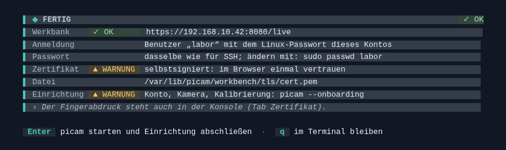
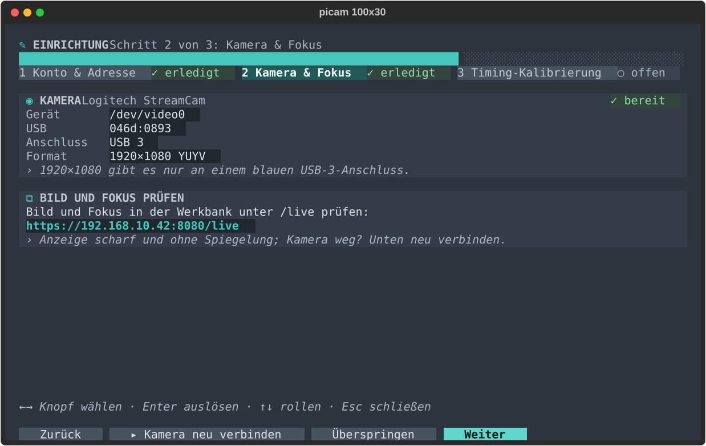

# Installer für einen separaten Linux-Rechner

[In einer Zeile installieren](#installation-in-einer-zeile) · [Timing kalibrieren](#timing-kalibrieren) · [Screenshots](#screenshots) · [Aktualisieren](#update-auf-die-neueste-version)

Der Installer richtet eine Werkbank in neuen Zielverzeichnissen ein. Für
eine vorhandene Release-Installation ist [`picam update`](#update-auf-die-neueste-version)
der Wartungsweg. Bootdateien, Benutzergruppen und Tailscale bleiben bei der
Installation unverändert. Ein Aufruf mit Angaben auf der Befehlszeile zeigt
ohne `--apply` den Plan.

**Nach der Installation** die ausgegebene Werkbank-Adresse (`/live`) öffnen,
die Anzeige [einrichten und bestätigen](anleitung/10-kamera-livevorschau.md#anzeige-einrichten)
und anschließend das [Timing kalibrieren](#timing-kalibrieren). Die
Kalibrierung startet die Werkbank neu. Richte die Anzeige danach erneut ein
und bestätige sie, bevor du den
[ersten Lauf startest](anleitung/10-kamera-livevorschau.md#lauf-und-wertstatus).

## Installation in einer Zeile

Auf einem neuen Pi mit Debian/Raspberry Pi OS 13 als Bediener in einem
Terminal oder einer SSH-Sitzung mit TTY ausführen.

```bash
curl -fsSL https://raw.githubusercontent.com/LeoMESysteme/picam-ai/master/get-picam.sh | bash
```

Der Bootstrap holt Archiv und SHA-256-Datei des
[aktuellen stabilen Release](https://github.com/LeoMESysteme/picam-ai/releases/latest)
vom öffentlichen GitHub-Mirror. Nach der Prüfung startet er den geführten
Installer. Bei SSH ohne TTY zuerst `ssh -t` verwenden. Für Skripte das
geprüfte Archiv lokal bereitstellen und
[mit ausdrücklichen Angaben installieren](#installation-zuerst-planen).
Eine bestimmte stabile Version lässt sich mit
`| bash -s -- --version v1.1.1` am Ende des Befehls auswählen.
Vorausgesetzt sind Bash, curl, tar, sha256sum und Python 3. Der Installer
fragt bei einer Systeminstallation selbst nach sudo.

## Geführt installieren

Releasearchiv und Prüfsummendatei auf den neuen Pi kopieren. Im Terminal
zuerst die Prüfsumme prüfen, danach entpacken und den Installer starten.

```bash
sha256sum -c picam-1.1.1.tar.gz.sha256 && \
  tar xzf picam-1.1.1.tar.gz && \
  (cd picam && ./install.sh --guided --source ../picam-1.1.1.tar.gz)
```

Der geführte Modus prüft zuerst System, Archiv und Debian-Pakete und fragt
dann nur, was er nicht ableiten kann: Installationsart (Systemdienst,
Benutzerdienst, portabel), Dienstkonto, Adresse für Windows (die erkannten
Schnittstellen stehen zur Auswahl) und Port. Danach zeigt er den Plan und
installiert erst nach `j`. Für die Systeminstallation übergibt er die
festen Antworten an `sudo`. Am Ende verlinkt er den Befehl `picam` und
fragt gesondert, ob der Dienst jetzt starten und beim Booten automatisch
starten soll (`systemctl enable --now`); er wartet, bis `/live` antwortet.
Ohne Terminal (Skript, Pipe) gelten weiter die Pflichtangaben unten.

Bei `./install.sh` ohne Argumente sucht der geführte Installer das Archiv
im Skriptordner, dessen Elternordner und im aktuellen Ordner. Findet er
keines, fragt er nach Pfad oder HTTPS-Adresse. Für eine HTTPS-Adresse
fragt er zusätzlich nach dem getrennt erhaltenen SHA-256.

Bedienung im Terminal: Auswahlen sind Menüs (`↑`/`↓` oder `j`/`k` wählen,
`Enter` übernimmt, `Leertaste` schaltet Komponenten an/aus, Ziffern wählen
direkt, `Esc`/`q` bricht ab; bei Ja/Nein auch `j`/`n`). Freie Eingaben
(Port, Ordner, eigene Adresse, Archivpfad) zeigen die Vorgabe
(„Enter = …“) und melden Fehler sofort unter der Eingabe. Zu Beginn läuft
kurz das ME-Logo (jede Taste überspringt, `PICAM_INTRO=0` oder `NO_COLOR`
schalten es ab); lange Schritte zeigen Drehzeichen mit Laufzeit, die
Installation eine Schrittliste mit ✓/✗ und Gesamtbalken. Ohne Terminal,
mit `TERM=dumb` oder in Skripten bleibt die einfache Texteingabe.

**Aussehen und Ende.** Der Installer benutzt die Formsprache der Konsole:
Abschnittsbänder, Karten mit abgestuftem Hintergrund und Abzeichen
(OK/WARNUNG/FEHLER/AUS) in der Palette „Schiefer“ (24-Bit-Farben auch ohne
`COLORTERM`; `PICAM_COLORS=256|16` oder `TERM=linux` rechnen herunter,
`NO_COLOR` und Terminals ohne UTF-8 geben `[OK]` und ASCII-Zeichen). Die Zeichen
✔ ⚙ ⏸ ⏹ ℹ kommen nie vor (sie verrutschen im Windows-Terminal über SSH). Am Ende
zeigt die Karte „Fertig“ die Adresse der Werkbank, die Anmeldung (das Linux-Konto
des Bedieners mit seinem Passwort, dasselbe wie für SSH; ändern mit
`sudo passwd KONTO`) und das selbstsignierte Zertifikat mit SHA-256-Fingerabdruck.
Danach: **Enter** startet `picam --onboarding` (der neue Befehl dieser Installation,
per `exec`; läuft der Installer als root, als Bediener über `sudo -u KONTO -H`,
ersatzweise `runuser`), **q** bleibt im Terminal. Ohne Terminal, mit `TERM=dumb`
oder in Skripten wird nichts gefragt, der Befehl steht nur im Text.

**Einrichtungsassistent (Onboarding).** Die Konsole öffnet beim ersten Start einer
installierten Werkbank einen Assistenten mit drei Schritten und
Fortschrittsleiste: **Konto & Adresse** (Adresse der Werkbank, Anmeldung mit
Linux-Konto und Passwort, Zertifikat im Browser vertrauen mit Fingerabdruck),
**Kamera & Fokus** (StreamCam erkannt, USB 3, 1920×1080; Bild und Fokus in der
Werkbank unter `/live` prüfen; Kamera neu verbinden) und **Timing-Kalibrierung**
(Stand, Erklärung, Kalibrierbildschirm wie im Tab Kamera mit `m`; ohne Adapter
oder bei laufender Werkbank steht der Sperrgrund da). Weiter, Zurück und
Überspringen sind Knöpfe (`←`/`→`/Tab wechseln, Enter löst aus, `Esc`
schließt). Der Assistent ändert nichts selbst. Jeder Abschluss, auch `Esc`,
legt die Marke `onboarding.json` im Datenordner der Werkbank ab (ersatzweise
`~/.config/picam/`); danach startet er nicht mehr von selbst. Erneut öffnen:
`picam --onboarding` oder in den Einstellungen „Einrichtung erneut“ (`e`).

**Optionale Komponente me-fastfetch** (standardmäßig an, im Menü
abwählbar, `--with-fastfetch`/`--without-fastfetch`): ME-Logo mit
Systemübersicht beim SSH-Login des Bedienkontos. Installiert das Paket
`fastfetch` (nur im Systemmodus), legt `~/.local/share/me-fastfetch/`,
`~/.local/bin/me-fastfetch` und `~/.config/fastfetch/` im Konto an (dem
Konto gehörend, abweichende Dateien vorher als `.vor-picam-<Zeit>`
gesichert) und einen markierten Block in `~/.bashrc` (gesichert, nur bei
interaktiven SSH-Logins). Ruft `.bashrc` fastfetch schon auf, bleibt sie
unverändert. Ein Fehler hier macht die Produktinstallation nicht rückgängig.

## Screenshots

### Abschlusskarte des Installers

Hier stehen die Werkbank-Adresse und das Konto. Mit **Enter** öffnest du
die Konsole mit der geführten Einrichtung. Die Aufnahme zeigt Beispieldaten.



### Konsole nach der Installation

Der Einrichtungsassistent zeigt Adresse, Kamera und Timing-Kalibrierung
nacheinander. Mit `picam --onboarding` kannst du ihn erneut öffnen.



## Verwalten mit `picam`

`picam` ohne Argument öffnet im Terminal die Verwaltungskonsole. Oben
stehen die Tabs: Dashboard (1), Lauf (2), Dienst (3), Kamera (4),
Ausgabe (5), Zertifikat (6), Speicher (7), Netzwerk (8), UART (9),
Konto (0), Protokoll (`l`) und Einstellungen (`c`); `←`/`→` wechseln,
Tabs und Knöpfe sind auch per Maus klickbar. Das Dashboard zeigt links den
Lauf und die häufigsten Aktionen (Werkbank starten/stoppen, neu starten,
Kamera neu starten, UART-Empfang der Brücke), rechts alle Bereiche mit
CPU, RAM und Temperatur. Der Tab Lauf zeigt einen laufenden Messlauf nur
lesend (Zählwerte, 60-s-Band, letzter Wert mit Alter, Latenz, Margin).
`i` erklärt den aktuellen Tab, `?` zeigt alle Tasten, die Tasten des Tabs
stehen in der untersten Zeile. Neue Fehler (Dienst ausgefallen,
Kamera, Ausgabe, Lauf) melden sich einmal als Fenster mit Optionen.

Jede Aktion zeigt vorher den genauen Befehl und startet auf „Abbrechen“.
Dienst- und Kameraaktionen sind gesperrt, solange ein Lauf, eine
Einrichtung oder eine Diagnosekopie aktiv ist oder der Laufstatus
unbekannt ist. Läufe startet und beendet nur die Werkbank im Browser.
Angemeldet wird an der Werkbank mit dem Linux-Konto des Dienstes und
dessen Passwort (Tab Konto, Einstellungen und Ende der Installation nennen
das Konto); ändern lässt es sich mit `sudo passwd KONTO`.

Dieselben Aufgaben gibt es als Einzelbefehle für SSH und Skripte:

| Befehl | Zweck |
| --- | --- |
| `picam status [--json]` | Kurzstatus |
| `picam doctor [--json]` | alle Prüfungen mit Abhilfe; Exit 0 OK, 1 Fehler, 2 Warnung |
| `picam logs [-n N] [-f]` | Protokoll des Dienstes |
| `picam start` / `stop` / `restart` | Dienst; Stopp während eines Laufs: Exit 3 (nur `--force` überstimmt) |
| `picam config [get KEY]` | Konfiguration lesen |
| `picam config set KEY WERT` | `port`, `bridge_name`, `bridge_discovery`; geprüft, wirksam nach `picam restart` |
| `picam update [--source ARCHIV \| --rollback]` | neueste stabile oder ausdrücklich gewählte Version mit Rückweg |
| `picam --version` | Version der Werkbank |
| `picam aufraeumen [--tage N]` | alte Läufe auflisten, nach Rückfrage löschen |
| `picam setup` | offene Einrichtungspunkte nacheinander, Befehle einzeln nach Rückfrage |
| `picam --onboarding` | Konsole mit dem Einrichtungsassistenten (Konto & Adresse, Kamera & Fokus, Timing-Kalibrierung) |
| `picam kalibrieren [--pruefen \| --import DATEI]` | Timing-Kalibrierung bei der Inbetriebnahme (USB-RS232-Adapter vorübergehend), siehe unten |
| `picam url` | Adresse der Werkbank |

`--no-color` (oder `NO_COLOR`) und `--ascii` gelten für alle Befehle.
Die Konsole nutzt 24-Bit-Farben, auch wenn das Terminal `COLORTERM` nicht
setzt (typisch bei SSH aus Windows); `PICAM_COLORS=256` schaltet auf 256
Farben. In tmux braucht der Client dafür das Merkmal `RGB`
(`set -as terminal-features ',xterm-256color:RGB'` in `~/.tmux.conf`), sonst
rechnet tmux selbst auf 256 Farben herunter. Farbvariante: `PICAM_THEME=schiefer|petrol|hell`.
Die Konsole beginnt mit einem kurzen Startbild (ME-Logo und
Punktmatrix, darunter die ersten Prüfergebnisse). Es endet von selbst,
sobald der Status da ist, jede Taste überspringt es. `--no-intro` oder
`PICAM_INTRO=0` lassen es weg, `TEXTUAL_ANIMATIONS=none` schaltet alle
Bewegungen ab. Ab 34 Zeilen zeigt das Dashboard die letzten Meldungen
des Dienstes.
`picam` findet die Instanz selbst: `/etc/picam/config.toml`,
`~/.config/picam/config.toml` oder `--config PFAD`. Auf dem
Entwicklungs-Pi ohne Installation verwaltet es den mit
`scripts/werkbank-dienst.sh` gestarteten Benutzerdienst und merkt sich
dessen Startbefehl. Die Adresse ist in der Konsole nur lesbar, weil sie im
Zertifikat und in den Kopplungen steht.

## Lieferumfang

- `install.sh`: Einstieg aus einem Checkout oder entpackten Release.
- `scripts/install.py`: gleicher Installer direkt mit Python.
- `picam-install.pyz`: eigenständige Auslieferung derselben Engine; mit
  `python3 picam-install.pyz ...` ohne Checkout oder Archiv-Entpacken starten.
- `scripts/build-release.py`: versioniertes Archiv mit Inhalts-Hashes,
  Code, Installer und geprüfter Leservorlage.
- `serve --config`: ausdrückliche TOML-Konfiguration für die neue Instanz.

Der [öffentliche Release v1.1.1](https://github.com/LeoMESysteme/picam-ai/releases/tag/v1.1.1)
enthält picam 1.1.1 mit Prüfsummendatei und die separat zu installierende
GSVmulti-Brücke 1.1.0 (Setup, portable EXE, Prüfsummen). Version 1.1.1
korrigiert die Programmdateirechte beim Bootstrap und bei Updates.

## Systeme und Fallbacks

| Umgebung | Verhalten |
| --- | --- |
| Linux mit Python >= 3.13 und passenden Systembibliotheken | Fähigkeitenprüfung; System-, Benutzer- oder portable Installation |
| Debian/Raspberry Pi OS 13, Python 3.13 | Primärer Installationsweg; optional apt mit ausdrücklichem Opt-in |
| Debian/Raspberry Pi OS 12 (Bookworm), Standard-Python 3.11 | Verständliche Ablehnung; neues OS auf dem zweiten Pi oder ausdrücklich ausgewählter ABI-passender Interpreter |
| Ubuntu 24.04, Standard-Python 3.12 | Gleiche Prüfung; kein stiller Python-/OS-Umbau |
| Andere Linux-Distribution / andere Architektur | Kein pauschaler Versionsfilter; notwendige Importe werden mit dem gewählten Python wirklich ausgeführt. Pakete dort manuell bereitstellen |
| Linux-PC ohne Pi-Serienkennung | `--without-bridge`: Browser-Werkbank ohne Pi-Brückenidentität; keine erfundene Ersatzkennung |
| Kein laufendes systemd oder kein Benutzerbus | Dienstmodus wird abgelehnt, `--mode portable` als Alternative genannt |
| Fehlende/ABI-inkompatible native Python-Module | Abbruch mit betroffenen Modulen; keine pip-Ersatzkopien von NumPy/OpenCV/Serial |
| Windows/macOS | Pi-Werkbank-Installer abgelehnt; keine versprochene Plattformkompatibilität |

Die Python-Versionsunterschiede sind in den
[Debian-Releasehinweisen](https://www.debian.org/releases/trixie/release-notes/whats-new.en.html)
und im [Ubuntu-Paketstand](https://packages.ubuntu.com/noble/python3)
dokumentiert. Die Regeln zu apt und venv entsprechen der
[Raspberry-Pi-Dokumentation](https://www.raspberrypi.com/documentation/computers/os.html).

Ein selbst gebautes Python 3.13 auf Bookworm reicht allein nicht:
OpenCV/NumPy/PAM und weitere native Module müssen für genau diesen
Interpreter passen. Der Installer fügt keine Fremdrepositories hinzu und
kompiliert keine neue Python-Version. Ein neues Image auf einem zweiten Pi
ist der einfachere Weg, wenn diese Voraussetzungen fehlen.

`textual` für die bestehende TUI und `zeroconf` für optionale Discovery sind
keine Voraussetzung für den normalen Dienststart. Sie stehen weiterhin in
der vollständigen Debian-Paketliste. Discovery wird nicht automatisch aktiviert.

## Release bauen

Im getrennten Entwicklungs-Checkout mit dessen eigener Python-Umgebung:

```bash
./.venv/bin/python scripts/build-release.py \
  --output /absoluter/lieferordner/picam-1.1.1.tar.gz \
  --release-id 1.1.1
(cd /absoluter/lieferordner && sha256sum picam-1.1.1.tar.gz > picam-1.1.1.tar.gz.sha256)
```

Das Ausgabeverzeichnis muss bereits existieren und außerhalb des
Quell-Worktrees liegen; eine vorhandene Ausgabedatei wird nicht ersetzt.
Der Release-Bau liest die Vorlage aus dem Sensorpaket `gsv2as-161a` im
Checkout und prüft ihren SHA-256. Für bestehende Installationen enthält das
Archiv dieselben Bytes auch am bisherigen Vorlagenpfad.
Bei einer stabilen Release-ID `X.Y.Z` trägt auch die `VERSION` im Archiv
diesen Wert. Daraus liest setuptools die Paketversion. `picam --version`
und die Konsole zeigen die Release-ID aus dem Manifest. Lokale Testbauten
können eine ID wie `rc-<commit>` verwenden.
Kalibrierung, Laufdaten, Schlüssel, Kopplungen und venv werden nicht geliefert.
`release.json` nennt Commit, abweichenden Arbeitsstand (`dirty`) und
SHA-256 jeder gelieferten Datei. Der Archivbau ist reproduzierbar für
identische Eingabedateien und Metadaten.

Archiv und Installer können per Datei/USB übertragen werden. Wenn der
Installer aus dem Archiv verwendet wird, zuerst den separat erhaltenen
Archivhash prüfen und erst danach das vertrauenswürdige Archiv entpacken.
Ein Manifest im Archiv allein ist kein Herkunftsnachweis.

Die eigenständige Installer-Datei lässt sich mit Standardmitteln bauen:

```python
import zipapp
zipapp.create_archive(
    'packaging', target='/absoluter/lieferordner/picam-install.pyz',
    main='picam_installer.engine:main', interpreter='/usr/bin/env python3',
    filter=lambda p: p.parts[0] == 'picam_installer' and '__pycache__' not in p.parts,
)
```

Sie enthält nur die Installer-Engine und braucht keine Produktbibliotheken
im Bootstrap-Interpreter. Die Produktlaufzeit wird getrennt geprüft.

## Release veröffentlichen

Setze die gewünschte Version in `VERSION`, schreibe den Abschnitt `## X.Y.Z` im
CHANGELOG und tagge den sauberen Stand als `vX.Y.Z`. Der Tag muss auf
`HEAD` zeigen und vor dem Upload auf dem GitHub-Mirror vorhanden sein.

```bash
./.venv/bin/python scripts/publish-release.py vX.Y.Z --dry-run

./.venv/bin/python scripts/publish-release.py vX.Y.Z
```

Der Probelauf prüft den lokalen Stand und zeigt die Befehle an. Der echte
Lauf baut lokal, prüft das Manifest auf Tag-Version, Commit und
`"dirty": false` und lädt `picam-X.Y.Z.tar.gz` und
`picam-X.Y.Z.tar.gz.sha256` mit der authentifizierten GitHub CLI (`gh`) hoch.
`--notes-file DATEI` erlaubt eigene Release-Notes. Die Windows-Dateien
werden separat gebaut und zum Release hinzugefügt. Auf Forgejo wurde
v1.1.1 mit Pi-Archiv, Prüfsumme und Windows-Dateien von Hand angelegt.
Die [Automatisierung des Forgejo-Uploads](../TODO.md#repo-aufraumen-2611)
steht aus. Für einen Umzug des Mirrors die Einstellungen in
`src/dispread/release_source.py` und im eigenständigen `get-picam.sh` gemeinsam
ändern und die dokumentierten Aufrufe aktualisieren.

## Installation zuerst planen

Diese Befehle sind Beispiele für den **neuen Zielrechner**. Das vorhandene
Bedienerkonto, die dort erreichbare Adresse und einen freien Port einsetzen.

```bash
./install.sh --source /pfad/picam-release.tar.gz \
  --mode system --user labor --host pi-neu.local --port 8080 --json
```

Mit der eigenständigen Lieferung denselben Aufruf mit
`python3 /pfad/picam-install.pyz` statt `./install.sh` beginnen.

Für eine HTTPS-Lieferung ist zusätzlich der getrennt erhaltene Hash nötig:

```bash
./install.sh --source https://eigener-server/picam-release.tar.gz \
  --sha256 'hier-den-tatsaechlichen-64-stelligen-hash-einsetzen' \
  --mode system --user labor --host pi-neu.local
```

HTTP, Zugangsdaten im URL-Benutzerfeld, unsichere Weiterleitungen, falsche
Hashes, Archivlinks, Pfadausbrüche und unvollständige Pakete werden abgelehnt.
Die Downloadgröße und die entpackten Inhalte sind begrenzt. Der Plan kann
eine HTTPS-Quelle lesen; er legt keine Download- oder Zielverzeichnisse an.

## Drei Installationsarten

| Modus | Code | Daten / Konfiguration | Start |
| --- | --- | --- | --- |
| `system` | `/opt/picam/releases/<id>`, `current` | `/var/lib/picam`, `/etc/picam/config.toml` | System-Unit unter vorhandenem Bedienerkonto |
| `user` | `~/.local/share/picam/releases/<id>` | `~/.local/state/picam`, `~/.config/picam/config.toml` | Benutzer-Unit, aktiver Benutzerbus erforderlich |
| `portable` | `<prefix>/releases/<id>` | `<prefix>/data`, `<prefix>/config/config.toml`, `<prefix>/run` | Manueller Prozess; kein Dienstmanager |

Benutzer- und portable Installation unter dem Bedienerkonto ausführen,
ohne sudo. Das Dienstkonto muss weiterhin dasselbe Konto sein, gegen das
die Werkbank die PAM-Anmeldung prüft. Der Installer legt keine Konten und
keine Passwörter an.

Der geprüfte Plan wird durch Hinzufügen von `--apply` ausgeführt:

```bash
# Systemmodus: nur auf dem neuen Zielrechner administrativ ausführen.
sudo ./install.sh --source /pfad/picam-release.tar.gz \
  --mode system --user labor --host pi-neu.local --port 8080 --apply

# Alternativ vollständig im eigenen Home, ohne Dienstmanager:
./install.sh --source /pfad/picam-release.tar.gz \
  --mode portable --prefix "$HOME/picam-neu" \
  --user "$(id -un)" --host pi-neu.local --port 8080 --apply
```

`--python /absoluter/pfad/python3` wählt einen anderen Produktinterpreter.
`PICAM_INSTALLER_PYTHON` wählt bei Bedarf den Interpreter des Bash-Einstiegs.
Der Installer selbst braucht Python >= 3.9, das Produkt weiterhin >= 3.13.

Fehlende Debian-Pakete installiert er nur mit zusätzlichem
`--install-packages`: system-Modus, root, normales `/usr/bin/python3`, kein
Staging. Die Liste ist `packaging/apt-packages.txt`; apt installiert nur
fehlende Pakete. Andere Paketmanager bleiben in dieser Lieferung manuell.
Der Installer führt kein `apt upgrade` aus.

## Staging und abweichende Pfade

`--root /neuer/absoluter/staging-pfad` legt sämtliche Zielpfade darunter.
Die Staging-Wurzel muss neu sein. Damit sind weder apt noch Aufrufe des
Dienstmanagers erlaubt. Die geschriebenen Pfade beziehen sich auf das
Staging-Verzeichnis; es ist kein nachträglich verschiebbares Image.

`--prefix`, `--data`, `--config` und `--unit-dir` erlauben neue absolute
Ziele. Der Socket eines systemd-Dienstes liegt im dafür verwalteten
RuntimeDirectory `picam`; abweichende `--runtime`-Pfade sind nur im
portablen Modus erlaubt. Pfade durch Symlinks werden nicht übernommen.

## Nach der Softwareinstallation

Das Ergebnis nennt den Startbefehl. In der geführten Installation startet
der Dienst nach der gesonderten Bestätigung. Bei einem Aufruf mit `--apply`
startet und aktiviert der Bediener den Dienst selbst. Auf dem neuen
Zielrechner Konfiguration, Gruppen `video`/`dialout`, Kamera und UART prüfen
und anschließend die Anlage kalibrieren.

Für einen Systemdienst sind danach administrativ beispielsweise nötig:

```bash
sudo systemctl daemon-reload
sudo systemctl start picam-werkbank.service
# Erst wenn der Betrieb geprüft ist, Autostart ausdrücklich aktivieren:
sudo systemctl enable picam-werkbank.service
```

Im Benutzermodus entsprechend `systemctl --user`. Betrieb nach Abmeldung
erfordert gegebenenfalls separat eingerichtetes Linger. Ein portabler Start
verwendet den ausgegebenen Python-/Konfigurationspfad direkt.

Der Installer erzeugt neue TLS- und Brückenidentitäten ausschließlich in
den neuen Datenverzeichnissen. Mit Brücke teilen sich Browser und Brücke
einen HTTPS-Listener: Das neue Identitätszertifikat enthält die Pi-URI und
den gewählten Host als DNS-/IP-SAN. Genau dieses öffentlich exportierte
Zertifikat liegt unter `workbench/tls/cert.pem` und wird für Browservertrauen
verwendet. Der Brückenschlüssel bleibt in der privaten Identitätsdatei.
Ohne Brücke erzeugt `init-tls` das klassische Zertifikat/Schlüsselpaar.
Bestehende Identitäten werden wegen einer neuen Adresse niemals automatisch
erneuert. Der Installer kopiert weder Identitäten noch
Timing-Kalibrierung vom bestehenden Pi. Eine fehlende gültige Kalibrierung
sperrt weiterhin den Messstart. Softwareinstallation und erreichbare
Werkbank sind keine Hardware- oder Messabnahme.

<a name="timing-kalibrieren"></a>

### Timing-Kalibrierung bei der Inbetriebnahme (RS232 nur einmal)

Die Kalibrierung misst die Zeit vom seriellen GSV-2AS-Telegramm bis zur
Änderung auf dem Display (Versatz δ, Sicherheitsfenster M). Diese Größe
ist nur mit dem RS232-Referenzstrom messbar; im Betrieb ist RS232 nicht
nötig. Deshalb wird jeder neue Pi einmal bei der Inbetriebnahme mit einem
vorübergehend angesteckten USB-RS232-Adapter (PL2303, `/dev/ttyUSB0`,
38400 Baud) kalibriert:

```bash
picam kalibrieren            # oder: Konsole, Tab Kamera, „Kalibrieren …“ (m)
```

**In der Konsole (Tab Kamera, `m` „Kalibrieren …“, `p` „Datei prüfen/importieren …“)**
läuft derselbe Ablauf in einem eigenen Bildschirm statt im pausierten Terminal:
Vorprüfung als Karte mit Abzeichen je Punkt (bei einem Problem „nicht möglich,
nichts geändert“ und nur Schließen), Plan mit deutlicher Bestätigung, dann die
Schrittliste (wartet / läuft / fertig / fehlgeschlagen / übersprungen), der
Fortschrittsbalken der Aufnahme, ein Protokollfeld und zuletzt das Ergebnis
(installiert, abgebrochen, nicht erkannt, Fehler; Kennzahlen, Normierung
zurückgestellt ja/nein, Werkbank wieder gestartet ja/nein, Laufordner). Meldungen
wie „Normierung nicht zurückgestellt“ stehen als rote Karte oben. Esc oder `q`
während des Laufs fordert nach Rückfrage den Abbruch an: er wirkt an der nächsten
Schrittgrenze, die Auswertung ist nicht abbrechbar (ein Abbruch dort verhindert
nur die Übernahme), und aufgeräumt (Normierung zurück, Werkbank starten) wird
immer. Der Bildschirm schließt erst, wenn alles durch ist. Braucht der
Dienststopp `sudo` (Systeminstallation) und ist es nicht frisch freigegeben, fragt
der Bildschirm das Passwort des Linux-Kontos in einem maskierten Feld ab; es wird
nur an `sudo` übergeben. `picam kalibrieren` auf der Kommandozeile bleibt
unverändert.

Ablauf: prüfen (Adapter liefert Telegramme, StreamCam an USB 3, bestätigte
Werkbank-Einrichtung vorhanden, kein Lauf/keine Einrichtung/keine
Diagnosekopie, Platz in `/dev/shm` und auf der Karte) → Plan und Rückfrage
→ Werkbank anhalten → Normierung und Dezimalpunkt des GSV-2AS sichern →
etwa 180 s aufnehmen mit Normierungssprüngen (`set norm`) → Normierung
zurückstellen und prüfen → Werkbank wieder starten (auf jedem Weg, auch
bei Abbruch) → auswerten → Datei nur bei gültigem Ergebnis (mindestens drei
messbare Ereignisse, Nulltest bestanden, Kamera stimmt) atomar nach
`<data>/calibration/timing-streamcam.json`. Aufnahme, Bericht, Sicherung
der Normierung und Protokoll bleiben unter `<data>/calibration/runs/<Zeit>/`.
Scheitert die Rückstellung, nennt picam den Befehl
`picam kalibrieren --rueckstellen <Datei>`.

Nach dem Wiederanlauf die Werkbank im Browser neu öffnen. Vor dem
ersten Messlauf die Anzeige erneut
[einrichten und bestätigen](anleitung/10-kamera-livevorschau.md#anzeige-einrichten).

Weitere Wege: `picam kalibrieren --pruefen [DATEI]` prüft eine Datei und
zeigt ihre Werte; `--import DATEI` übernimmt eine anderswo gemessene Datei
nur nach Warnung und getippter Bestätigung und legt eine Notiz mit Quelle
und SHA-256 daneben (gilt nur bei gleicher Kamera, gleichem Display und
Aufbau). `picam setup` bietet „kalibrieren“, „prüfen/importieren“ oder
„später“. Ohne gültige Kalibrierung bleibt der Laufstart gesperrt; die
Werte werden im Lauf nur vermerkt (`session.json`, `applied: false`).

Lokale Steuerbefehle müssen den Socket dieser Instanz verwenden, etwa
`dispread live status --socket /run/picam/control.sock` oder
`DISPREAD_SOCKET=/run/picam/control.sock dispread status`. Beim portablen
Betrieb stattdessen den ausgegebenen Runtime-Pfad einsetzen. Die bisherigen
CLI-Defaults für ältere Aufrufe bleiben erhalten.

## Wiederholung und Abbruch

Vorhandene Ziele werden abgelehnt. Das ist auch bei einem identischen
zweiten Aufruf beabsichtigt: keine stillschweigende Aktualisierung,
Migration, neue Identität oder Zertifikatserneuerung. Bei einem Fehler vor
Aktivierung werden nur die von diesem Aufruf angelegten Ziele aufgeräumt.
Der aktive Versionslink wird zuletzt angelegt.

## Deinstallieren

`install.sh --uninstall [--mode system|user|portable]` zeigt den Plan,
mit `--apply` wird er ausgeführt: Dienst stoppen und abmelden, Unit-Datei,
`picam`-Verknüpfung (nur wenn sie in die Installation zeigt) und
`releases/`, `current`, `previous` entfernen. Daten, Konfiguration,
Kopplungen und Kalibrierung bleiben als Bestand erhalten. Der Neuinstaller
verlangt neue Zielpfade. `--purge-data` löscht auch Daten und Konfiguration.
Die Deinstallation entfernt unveränderte me-fastfetch-Dateien laut
Manifest und sichert die `.bashrc`, bevor sie den markierten Block entfernt.
Hat der Installer das Paket `fastfetch` eingespielt, kann der Bediener es
mit `--remove-fastfetch-package` ebenfalls entfernen.
In der Konsole: Einstellungen, `x`. Zuerst zeigt ein Bildschirm den Plan des
Installers: Karte „Wird entfernt“ (Dienst, Programmversionen, Befehl `picam`
mit Pfaden), Karte „Bleibt erhalten“ (Daten, Einstellungen mit Pfaden),
ob `sudo` nötig ist und den Hinweis auf `--purge-data`. Der Knopf
„Deinstallieren …“ ist rot, der Fokus steht auf „Abbrechen“; bis dahin ist
nichts geändert. Nach der Bestätigung beendet sich die Konsole, und die
Deinstallation läuft im Terminal (nicht in einem pausierten Fenster):
`install.sh --uninstall … --guided` zeigt den Plan noch einmal in der
Formsprache der Konsole (Karten und Abzeichen, bei `NO_COLOR` und ohne
Terminal als einfacher Text), fragt, bis „deinstallieren“ eingetippt ist
(alles andere bricht ab, Exit 130), zeigt je Schritt den Fortschritt und
endet mit einer Zusammenfassung. Das Passwort für `sudo` fragt das Terminal
vor dem Plan ab. Ohne `--guided` bleibt es bei Plan und `--apply`.

## Zertifikat erneuern

In der Konsole: Tab Zertifikat, `n`. Der Bildschirm zeigt die Folgen, prüft
die Laufsperre (läuft eine Messung oder Einrichtung, ist die Erneuerung
gesperrt und nichts wird geändert), erneuert, startet den Dienst neu und
zeigt das Ergebnis.

* **Ohne Windows-Brücke** (`renew-tls`): Das Zertifikat wird mit demselben
  Schlüssel neu ausgestellt (alte Datei als `cert.pem.bak-<Zeit>`). Browser
  müssen dem neuen Zertifikat erneut vertrauen.
* **Mit Brücke** ist das Zertifikat die Brückenidentität (die Windows-App
  prüft dessen vollständigen SHA-256). Die Erneuerung stellt ein neues
  Zertifikat mit derselben Pi-ID, demselben Schlüssel und denselben Namen
  aus; die Sicherung (mit privatem Schlüssel) liegt in einem Ordner nur für
  das Dienstkonto. Danach muss **jede Windows-Brücke** das neue Profil
  `pi.dispread` laden (Werkbank im Browser, Windows-Brücke einrichten, oder
  auf dem Pi `dispread bridge export-profile …`) und neu koppeln; die
  Tokens auf dem Pi bleiben. Browser müssen neu vertrauen. Weil das jede
  Kopplung bricht, verlangt die Konsole das Eintippen von „erneuern“. Das
  Ergebnis nennt alter und neuer Fingerabdruck, Gültigkeit, Sicherung und die
  nächsten Schritte. Ohne Konsole: `dispread bridge identity --renew --yes`
  als Dienstkonto.

HTTPS lässt sich nicht abschalten (die Brücke setzt TLS voraus).

## UART-Ports ändern

In der Konsole: Tab UART, `p`. Der Bildschirm zeigt die Stiftleiste; Pin per
Pfeiltasten oder Mausklick wählen. Für den Pin öffnet sich ein Dropdown mit
den **wählbaren** UART-Funktionen (aktiv, oder braucht `config.txt` und
Pi-Neustart). Nicht wählbare (RX-Pin, belegte Konsole, SPI/I2C-Konflikt,
belegter Port) stehen mit Grund daneben. Getrennt davon wählt ein zweites
Dropdown die Referenz (USB-RS232-Adapter, stabile `by-id`-Namen). „Prüfen
und weiter“ zeigt eine Prüfseite mit Warnungen, den Diffs für `config.txt`
und die Instanzkonfiguration und was neu startet; nach der Bestätigung (und
bei Bedarf dem `sudo`-Passwort) schreibt der Worker mit Sicherung. Ein
nötiger Pi-Neustart wird nur als Befehl angezeigt (`sudo systemctl reboot`);
picam startet den Pi nie selbst. Pi-Pegel sind 3,3 V: nie direkt an RS-232.
Die Tabs Ausgabe und UART, die Kalibrierung und `picam einrichten` nutzen
danach den konfigurierten Ausgang und Referenzport; `picam kalibrieren
--port` überstimmt nur, wenn angegeben.

## Update auf die neueste Version

**Umstieg von einem Releasekandidaten (`rc-…`, vor 1.1.0):** Wenn
`picam update` „Bezugsquelle noch nicht festgelegt“ meldet, einmal das
Archiv einer stabilen Version mit Prüfsumme laden und als Quelle angeben.
Danach reicht `picam update`.

```bash
gh release download v1.1.1 --repo LeoMESysteme/picam-ai --pattern 'picam-1.1.1.tar.gz*'
sha256sum -c picam-1.1.1.tar.gz.sha256 && \
  picam update --source picam-1.1.1.tar.gz --sha256 "$(cut -d' ' -f1 picam-1.1.1.tar.gz.sha256)"
```

Portable Installationen haben kein `picam update` (neu installieren).

Ein erneuter Installeraufruf aktualisiert nichts. Updates laufen über
`picam update` (System- und Benutzerinstallation):

```bash
picam update                               # neueste stabile Version suchen und nach Bestätigung installieren
picam update --source picam-1.1.1.tar.gz    # bestimmtes, bereits geprüftes Archiv wählen
picam update --rollback                    # zurück auf die vorige Version
picam update --check                       # aktive, vorige, installierte Versionen
picam update --activate 1.1.1              # vorbereitete Version aktivieren
```

`picam update` liest den neuesten veröffentlichten stabilen Release des
öffentlichen Mirrors ohne GitHub-Token. Ist er bereits aktiv, meldet das
Programm `bereits aktuell (X)`. Ein älterer Release erfordert eine
ausdrücklich angegebene Quelle. Entwicklungslieferungen wie
`rc-<commit>` gelten als älter als stabile Versionen. Jeder automatische
Download braucht die passende SHA-256-Datei. `--yes` bestätigt das Update
auf der Kommandozeile.

Ablauf: Laufsperre prüfen, neue Version unter `releases/<id>` vorbereiten
(Dateien, eigene venv, Selbsttest), Laufsperre erneut prüfen, `current`
atomar umschalten (die bisherige wird `previous`), Dienst neu starten und
auf `/live` warten. Antwortet die neue Version nicht, schaltet picam auf
die vorige zurück und startet sie neu. Daten, Konfiguration, Identität und
Kalibrierung bleiben unverändert; die Konfiguration liest die Lesevorlage
über `current`. In der Konsole: Tab Dienst, `u` bzw. `z`. Nach `u` den Pfad
zum geprüften lokalen Archiv eingeben. Für eine eigene HTTPS-Quelle im
Terminal `picam update --source URL --sha256 HASH` verwenden. Die Konsole
zeigt Plan, Fortschritt, Protokoll und Ergebnis (alte und neue Version,
gegebenenfalls den Rückweg). Bei Erfolg bietet sie an, mit der neuen Version neu zu starten
(sie wird dann durch `<prefix>/current/.venv/bin/picam` ersetzt). Ein
sudo-Passwort wird nur dafür maskiert abgefragt. `z` schaltet gleich auf die
vorige Version zurück.

Grenze: Die Laufsperre ist eine Prüfung unmittelbar vor Vorbereitung und
Umschalten, keine atomare Wartungssperre im Dienst. Startet jemand genau
zwischen Prüfung und Neustart einen Lauf, bricht der Neustart ihn ab. Updates
deshalb nicht während laufender Messarbeit anstoßen.

Die bestehende Entwicklungsinstallation dieses Pi wird nicht übernommen;
dort gilt weiter `git pull` und `picam restart`.
